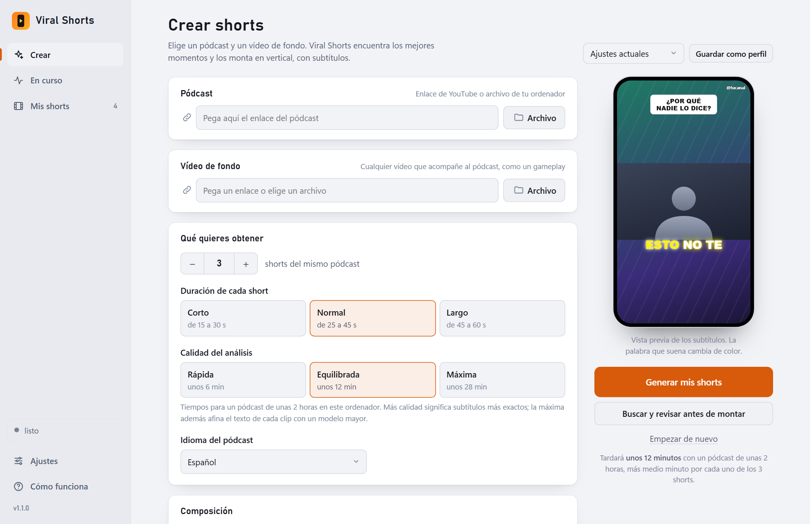

  

<h1 align="center">Viral Shorts</h1>

  <b>De un pódcast de horas a shorts verticales con subtítulos, en unos clics.</b> 
  Encuentra los mejores momentos, los recorta siguiendo la cara y los deja listos para TikTok, Reels y YouTube Shorts.

  
  
  
  

  <a href="https://github.com/practicas-hugosanz/viralshorts-releases/releases/latest"><b>⬇ Descargar la última versión para Windows</b></a>

  

## Qué es

Viral Shorts convierte un pódcast largo en una tanda de shorts verticales. Le das el enlace del pódcast y un vídeo de fondo (un gameplay, por ejemplo) y se encarga del resto:

1. **Encuentra los momentos buenos** con lo que más rebobina la gente en YouTube, la energía del audio y la transcripción.
2. **Los monta en vertical**: recorta siguiendo la cara, quita silencios, pone un zoom lento y quema los subtítulos palabra a palabra.
3. **Te deja cada short listo**, con su título, gancho y hashtags para copiar y publicar.

Todo se hace **en tu ordenador**: no hace falta cuenta ni suscripción. Con una clave de Claude los textos de publicación salen redactados; sin ella, se extraen de lo que ya dice el invitado.

## Qué incluye

- **Elegir bien**: preselección por *most replayed* y energía del audio, para no transcribir un pódcast de 3 horas entero; arranca donde empieza el tema; modo *revisar antes de montar*.
- **Montar bien**: reencuadre que sigue la cara, recorte de silencios, subtítulos con la palabra activa resaltada y aceleración por tarjeta gráfica cuando la hay.
- **Hacerlo tuyo**: composición (dividido, solo el pódcast o en el centro), cinco estilos de subtítulos, tu logo y tu usuario, y perfiles de ajustes con nombre.
- **Antes de montar**: corrige el texto de los subtítulos, recorta cada clip y elige su estilo; añade música que baja sola cuando habla alguien y una barra de progreso.
- **Acertar más con el texto**: afina los clips elegidos con un modelo de voz mayor, con nombres difíciles y correcciones fijas.
- **Cómodo**: aplicación de escritorio con instalador, transcripción en directo, cola de trabajos, biblioteca con búsqueda y actualizaciones automáticas.

## Capturas

<table>
  <tr>
    <td width="50%"> <b>En curso.</b> Cada paso, la transcripción en directo y la cola de trabajos.</td>
    <td width="50%"> <b>Revisión.</b> Marca los momentos que valen y corrige títulos y ganchos.</td>
  </tr>
  <tr>
    <td width="50%"> <b>Mis shorts.</b> Todo lo generado, con búsqueda, título editable y texto para copiar.</td>
    <td width="50%"> <b>Tema claro u oscuro</b>, según tu Windows.</td>
  </tr>
</table>

## Instalación

1. Descarga **`viralshorts-setup-<versión>.exe`** desde [la última versión](https://github.com/practicas-hugosanz/viralshorts-releases/releases/latest) y ejecútalo. Se instala para tu usuario, sin permisos de administrador.
2. Abre **Viral Shorts** desde el menú Inicio. La primera vez descarga ffmpeg, yt-dlp y whisper.cpp (unos 120 MB); las siguientes abre al momento.
3. Los modelos de voz (de 75 MB a 3 GB, según la calidad) se descargan solos, con barra de progreso, cuando hacen falta.

> Windows puede mostrar un aviso de SmartScreen porque el instalador todavía no está firmado: pulsa **Más información → Ejecutar de todos modos**.

**Requisitos:** Windows 10 o 11 de 64 bits y conexión a internet la primera vez. Necesita el *WebView2 Runtime* de Microsoft, que ya trae Windows 11 y las versiones recientes de Windows 10; si falta, se abre en el navegador.

## Tu primer short

1. En **Crear**, pega el enlace del pódcast y el del vídeo de fondo.
2. Elige cuántos shorts quieres, cuánto duran y la calidad del análisis (*Equilibrada* va bien para empezar).
3. Pulsa **Generar mis shorts** y mira cómo avanza en **En curso**. Cuando termina, están en **Mis shorts**.

## Actualizaciones

La aplicación mira sola si hay una versión nueva (al abrir y cada 3 horas) y ofrece instalarla con un clic: descarga el instalador, comprueba su huella SHA-256 y se reinicia ya actualizada. Las notas de cada versión están en [Releases](https://github.com/practicas-hugosanz/viralshorts-releases/releases).

## Desinstalar

Desde **Aplicaciones instaladas** de Windows. Al terminar pregunta si también quieres borrar las herramientas y modelos descargados (varios cientos de MB); tus shorts, en `Vídeos\viralshorts`, nunca se tocan.

## Problemas y sugerencias

Abre una [incidencia](https://github.com/practicas-hugosanz/viralshorts-releases/issues) contando qué pasó y la versión que usas (está abajo a la izquierda en la aplicación).

## Aviso legal

Montar un pódcast ajeno con gameplay ajeno y subirlo entra de lleno en Content ID y en las políticas de contenido no original de YouTube y TikTok. Con contenido propio, o con permiso, sin problema; si no, cuenta con reclamaciones y con posibles retiradas.
