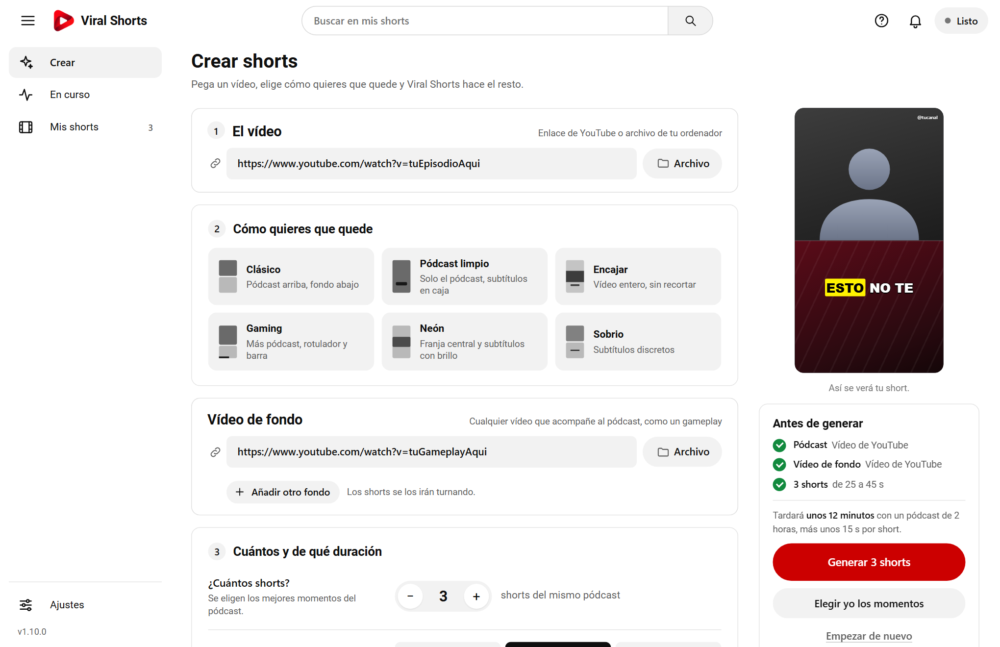
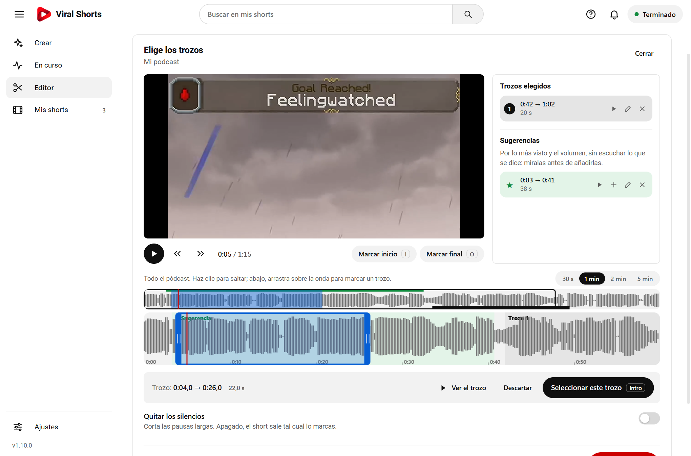
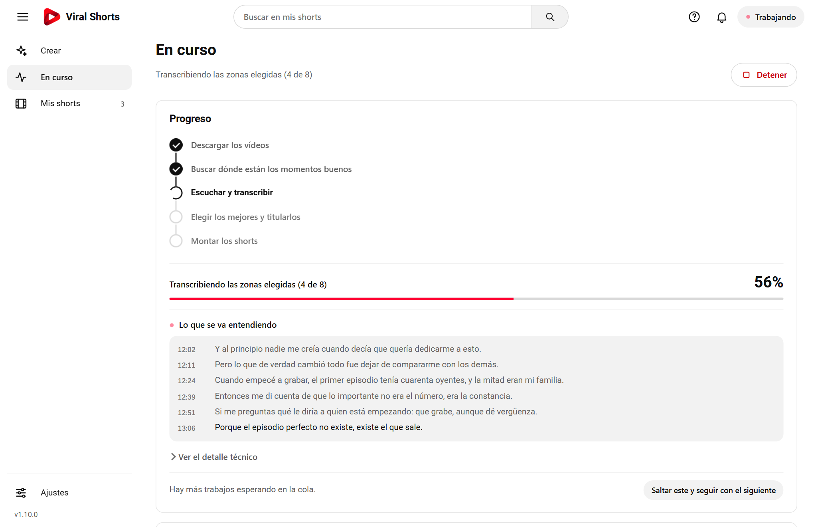
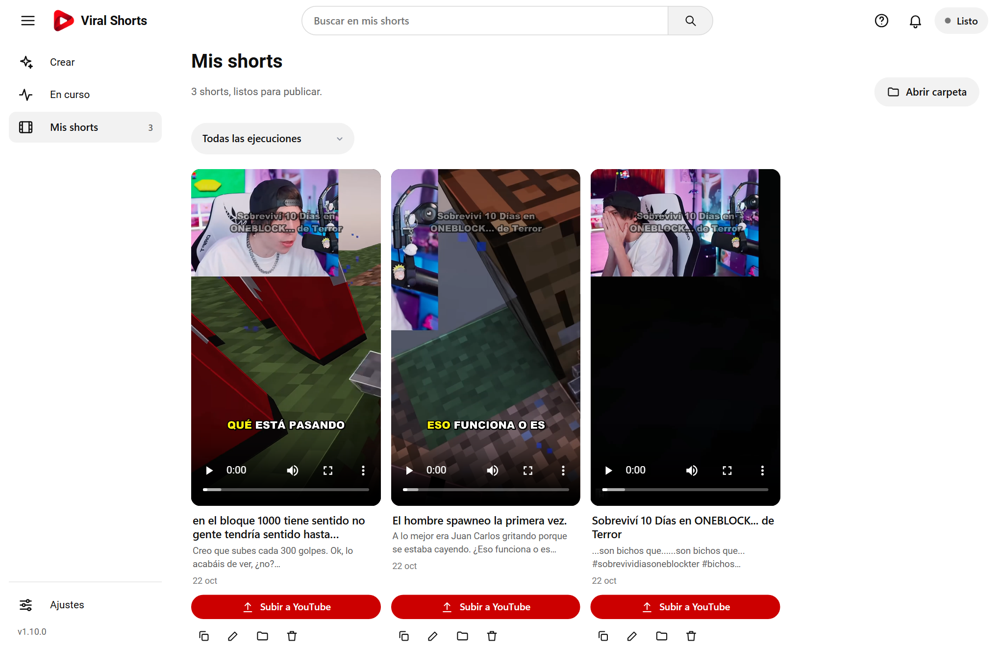
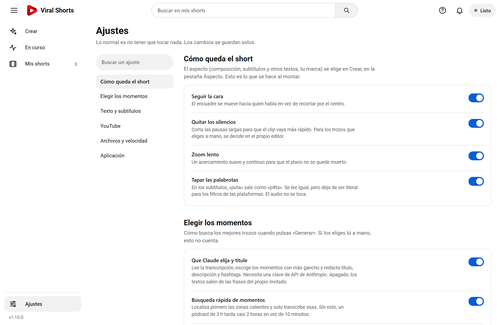
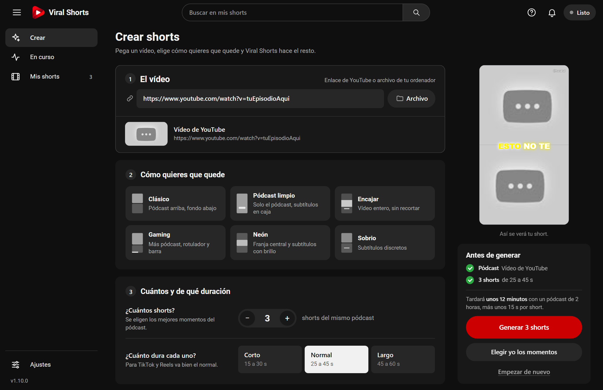

  

<h1 align="center">Viral Shorts</h1>

  <b>De un pódcast de horas a shorts verticales con subtítulos, en unos clics.</b> 
  Encuentra los mejores momentos, los recorta siguiendo la cara y los deja listos para TikTok, Reels y YouTube Shorts.

  
  
  
  

  <a href="https://github.com/practicas-hugosanz/viralshorts-releases/releases/latest"><b>⬇ Descargar la última versión para Windows</b></a>

  

## Qué es

Viral Shorts convierte un pódcast largo en una tanda de shorts verticales. Le das el enlace del pódcast y un vídeo de fondo (un gameplay, por ejemplo) y se encarga del resto:

1. **Encuentra los momentos buenos** con lo que más rebobina la gente en YouTube, la energía del audio y la transcripción.
2. **Los monta en vertical**: recorta siguiendo la cara, quita silencios, pone un zoom lento y quema los subtítulos palabra a palabra.
3. **Te deja cada short listo**, con su título, gancho y hashtags para copiar, o para subirlo a YouTube Shorts con un clic.

Todo se hace **en tu ordenador**: no hace falta cuenta ni suscripción. Con una clave de Claude los textos de publicación salen redactados; sin ella, se extraen de lo que ya dice el invitado.

## Qué incluye

**Elegir bien**
- Preselección por *most replayed* de YouTube y energía del audio: solo se transcribe lo que importa, así un pódcast de 3 horas no tarda 3 horas.
- Empieza donde empieza el tema, no a media frase.
- **Elegir yo los momentos**: el vídeo entero en un editor con línea de tiempo y los mejores momentos sugeridos. Cada trozo que marcas es un short.

**Montar bien**
- Reencuadre que sigue la cara de quien habla y recorte de silencios (a elegir en los trozos que marcas tú).
- Subtítulos palabra a palabra con la palabra activa resaltada, y las palabrotas tapadas si quieres. Sin frases inventadas en los silencios.
- Aceleración por tarjeta gráfica **NVIDIA, AMD o Intel**, también para transcribir.
- **Dos personas en pantalla partida**, y **Encajar**: el vídeo entero sin recortar, sobre una copia difuminada, ideal para grabaciones de pantalla.

**Hacerlo tuyo**
- **Plantillas** de un clic y **vista previa real** con tu vídeo, tus subtítulos y tu marca.
- **Cinco estilos de subtítulos** (o ninguno), tu logo y tu usuario, formatos 9:16, 4:5 y 1:1, efectos de sonido, portada con el gancho y pantalla final.
- **Subtítulos en otro idioma** y **emojis según lo que se dice**.
- **Varios vídeos de fondo** que se turnan, y música que baja sola cuando habla alguien.
- **Para editar fuera**: los subtítulos en `.srt` y el mismo short sin ningún texto encima.

**Cómodo de usar**
- **Retoca un short ya hecho** en el editor: la parte elegida, los subtítulos frase a frase, el estilo y el título. Se rehace solo ese, y se puede deshacer.
- Un vídeo corto se adapta solo: sale entero en un short.
- **Sube a YouTube Shorts** con un clic, o **prográmalos** para que se publiquen solos.
- **Sigue canales**: cuando publican un episodio nuevo, se pone en la cola solo.
- Transcripción en directo, cuánto queda, cola de trabajos, aviso al terminar y biblioteca con búsqueda.
- Borra el vídeo descargado al terminar para no llenar el disco, y se actualiza sola.

## Capturas

<table>
  <tr>
    <td width="50%"> <b>Editor.</b> Elige los trozos en una línea de tiempo, o retoca un short ya hecho: la parte elegida y los subtítulos, frase a frase.</td>
    <td width="50%"> <b>En curso.</b> Cada paso, cuánto queda, la transcripción en directo y la cola de trabajos.</td>
  </tr>
  <tr>
    <td width="50%"> <b>Mis shorts.</b> Todo lo generado, listo para retocar, copiar el texto o subir a YouTube.</td>
    <td width="50%"> <b>Ajustes.</b> Lo que normalmente no hace falta tocar, por apartados y con buscador.</td>
  </tr>
  <tr>
    <td colspan="2"> <b>Tema claro u oscuro</b>, según tu Windows.</td>
  </tr>
</table>

## Instalación

1. Descarga **`viralshorts-setup-<versión>.exe`** desde [la última versión](https://github.com/practicas-hugosanz/viralshorts-releases/releases/latest) y ejecútalo. Se instala para tu usuario, sin permisos de administrador.
2. Abre **Viral Shorts** desde el menú Inicio. La primera vez descarga ffmpeg, yt-dlp y whisper.cpp (unos 120 MB); las siguientes abre al momento.
3. Los modelos de voz (de 75 MB a 3 GB, según la calidad) se descargan solos, con barra de progreso, cuando hacen falta. Si tienes tarjeta gráfica, la aplicación te ofrece activarla con un clic.

> Windows puede mostrar un aviso de SmartScreen porque el instalador todavía no está firmado: pulsa **Más información → Ejecutar de todos modos**.

**Requisitos:** Windows 10 o 11 de 64 bits y conexión a internet la primera vez. Necesita el *WebView2 Runtime* de Microsoft, que ya trae Windows 11 y las versiones recientes de Windows 10; si falta, se abre en el navegador.

## Tu primer short

1. En **Crear**, pega el enlace del vídeo o elige un archivo.
2. Elige una plantilla. Si la que eliges usa vídeo de fondo (un gameplay, por ejemplo), pega también su enlace; si no, ni te lo pide. A la derecha ves cómo quedará.
3. Di cuántos shorts quieres y de qué duración, y pulsa **Generar** (el botón dice cuántos: «Generar 3 shorts»). Lo ves avanzar en **En curso** y, al terminar, están en **Mis shorts**.

¿Quieres afinar más? **Personalizar el aspecto** y **Texto e idioma** están plegados debajo. Y si prefieres decidir tú qué trozos se montan, usa **Elegir yo los momentos**: se abre el **Editor** con el vídeo y su línea de tiempo, con los mejores momentos sugeridos en verde. Marca el inicio y el final con los botones, con las teclas I y O o arrastrando sobre la onda, pulsa **Seleccionar este trozo** y, cuando tengas los que quieras, **Montar**.

## Actualizaciones

La aplicación mira sola si hay una versión nueva (al abrir y cada 3 horas) y ofrece instalarla con un clic: descarga el instalador, comprueba su huella SHA-256 y se reinicia ya actualizada. Las notas de cada versión están en [Releases](https://github.com/practicas-hugosanz/viralshorts-releases/releases).

## Desinstalar

Desde **Aplicaciones instaladas** de Windows. Al terminar pregunta si también quieres borrar las herramientas y modelos descargados (varios cientos de MB); tus shorts, en `Vídeos\viralshorts`, nunca se tocan.

## Problemas y sugerencias

Abre una [incidencia](https://github.com/practicas-hugosanz/viralshorts-releases/issues) contando qué pasó y la versión que usas (está abajo a la izquierda en la aplicación).

## Aviso legal

Montar un pódcast ajeno con gameplay ajeno y subirlo entra de lleno en Content ID y en las políticas de contenido no original de YouTube y TikTok. Con contenido propio, o con permiso, sin problema; si no, cuenta con reclamaciones y con posibles retiradas.
